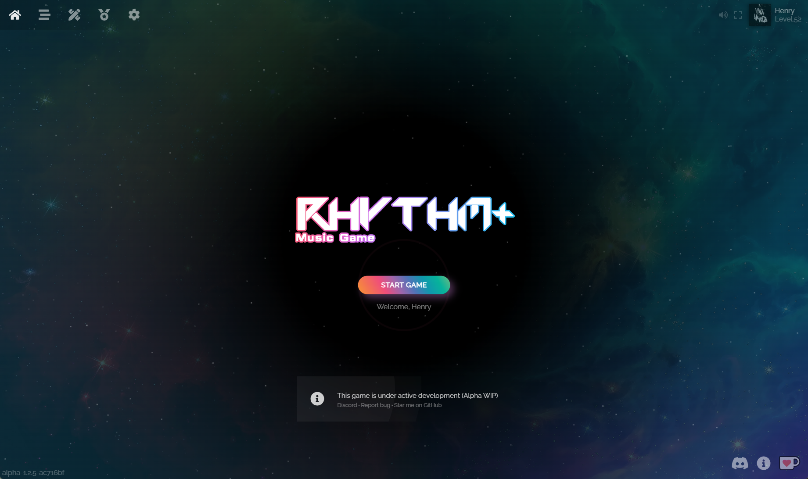
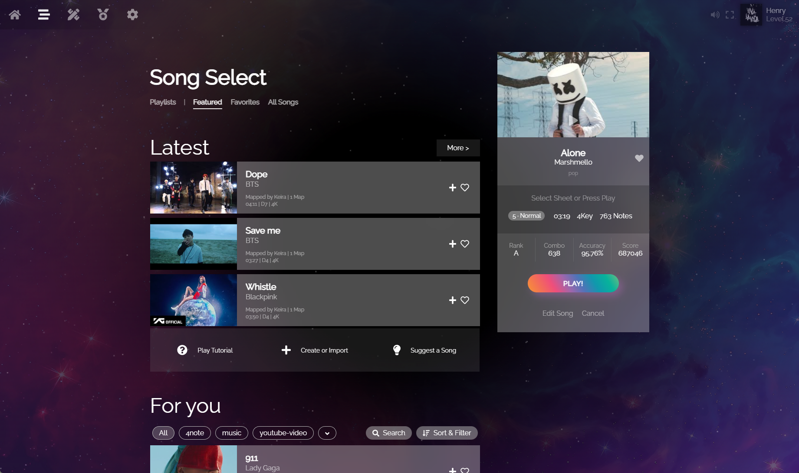
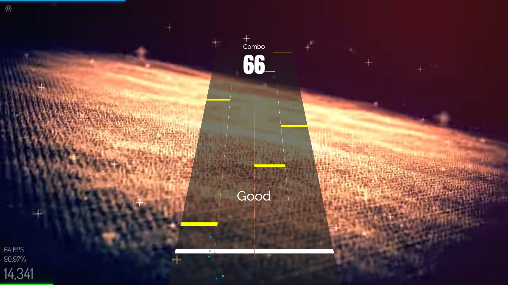
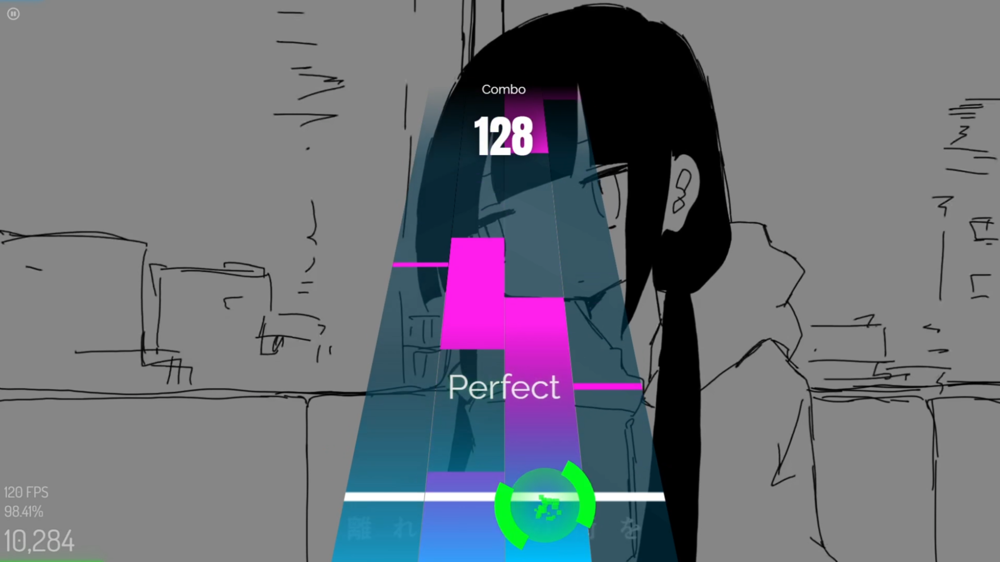
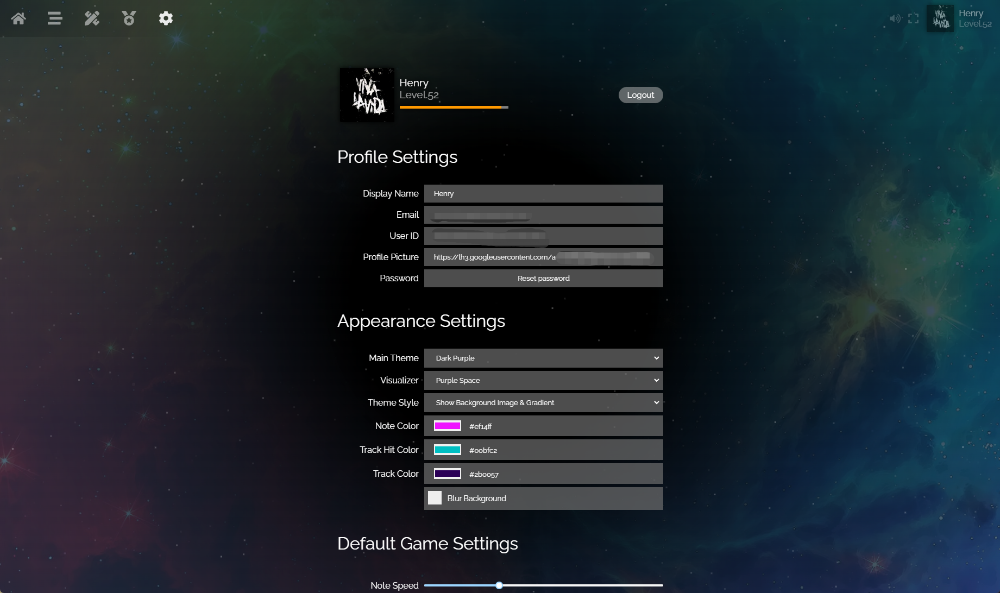
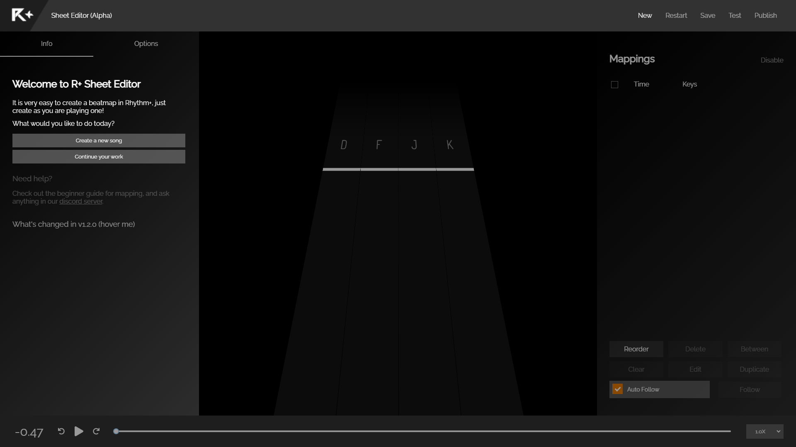
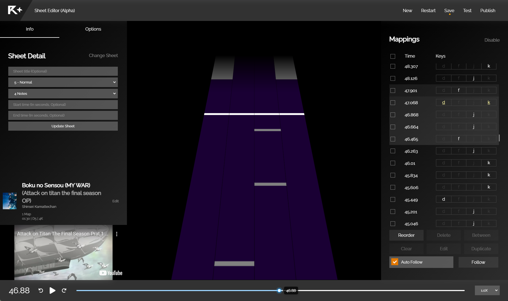

# Rhythm Plus Music Game

Rhythm Plus is a community-based web Vertical Scrolling Rhythm Game (VSRG) that allows you to create, play, and share songs with anyone!

- 🎮 **Instant Play:** Run directly in your browser
- 🌐 **Community Driven:** Share your creations and play levels made by the community
- 🛠️ **Built-in Editor:** Create your own levels with an intuitive sheet editor
- ☁️ **Cross-Device Sync:** Mark favorites, create playlists, and keep your progress updated anywhere
- 🎨 **Deep Customization:** Personalize your experience with custom skins and settings

## Gameplay

[**Play Now**](https://rhythm-plus.com/)

### Title Screen

### Song Select

### Gameplay

### Preferences

### Sheet Editor

Visit our [Wiki](https://wiki.rhythm-plus.com/) for more information. Join our [Discord server](https://discord.com/invite/ZGhnKp4) to get the latest updates!

> [!NOTE]
> This repository contains the source code for the legacy V1 version of Rhythm Plus which is built with **Vue.js 2**, **Vanilla Canvas 2D API** and **Firebase Firestore**.
>
> We are currently working on V2, the biggest update to Rhythm Plus. V2 is built with a modern stack including **Nuxt 3**, **TypeScript**, **PixiJS**, and **Babylon.js**, supporting custom skins, true 3D modes, SV, and much more! V2 is not yet open-sourced, please stay tuned!
>
> To learn more about V2 and stay updated, [join our Discord server](https://discord.com/invite/ZGhnKp4)!

## Contributors
[@henryzt](https://github.com/henryzt) [@robinWongM](https://github.com/robinWongM) [@jieyouxu](https://github.com/jieyouxu) [@KZHIWEI](https://github.com/KZHIWEI) [@yoyouC](https://github.com/yoyouC) [@Kouakiradou](https://github.com/Kouakiradou) [@Shadowhusky](https://github.com/Shadowhusky) [@splamei](https://github.com/splamei)
